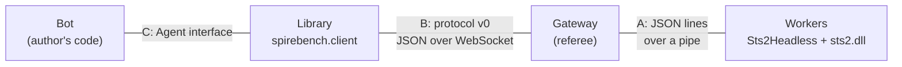
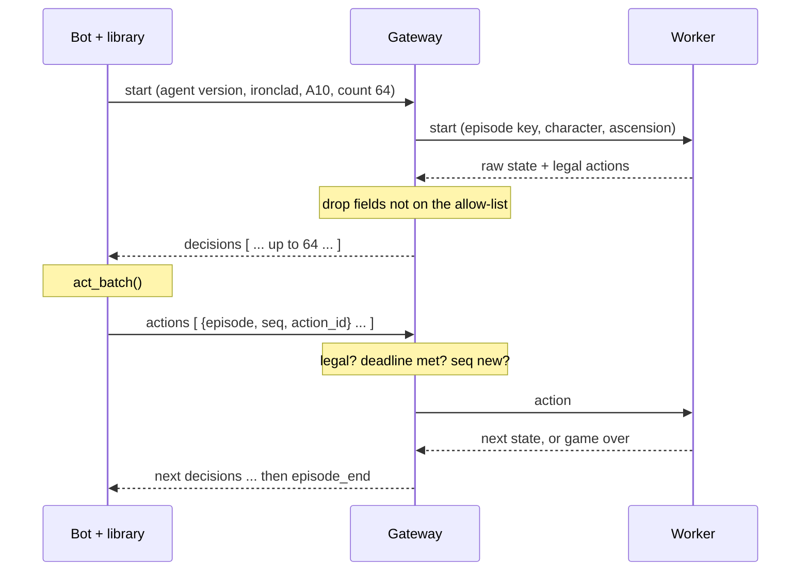

# Build plan

How a bot's move gets from the author's code to the real game and back, and
the order we build it in. It starts from Thomas Friedel's headless game,
which he has offered for the benchmark. It is a companion to the proposal,
[A Shared Benchmark for Slay the Spire 2 Bots](https://docs.google.com/document/d/17AXtsWNrIExi4oN7_xp_76xpGA9BN0kVhv9Z0MxMuCg/edit).

## Where we are

| Milestone | What it delivers | State |
|---|---|---|
| M0 | `Sts2Headless` builds here; full A10 runs measured | done, see [M0.md](M0.md) |
| M1 | One game end to end: schema v0, gateway, library, random bot on localhost | next |
| M2 | The loop under load: 64 in flight, batching, deadlines, errors, reconnect, allow-list, each guard shown to fail | |
| M3 | Keyed dice, the unkeyed-draw guard, exact replay | |
| M4 | Real bots through adapters (floor-climber, spire-mentor, cygn, maxoley) and the conformance kit | |
| M5 | Scoring, win streaks, owner reveal, practice key, static results page | |

Rules that hold throughout:

- No game files in the repo, ever. `.gitignore` blocks `*.dll`.
- Bots never reach the worker. The gateway forwards only `start` and `action`.
- A guard counts as built only once it has been shown to fail on a planted
  violation.

## Starting point: Thomas's headless game

spire-mentor (MIT) contains `Sts2Headless`, which runs the game's real
`sts2.dll` without Godot. It is driven by one JSON line in and one JSON line
out over stdin and stdout. spire-mentor uses it as the reference its Rust
engine is checked against. It ships no game files: `setup.sh` copies the DLLs
from your own Steam install and patches them locally. That matches the
proposal's rule that each operator runs their own copy of the game.

It supports builds v0.107.1 and v0.111.0, one binary per build, set at
compile time. spire-mentor's own benchmark (random fights, one warm process)
measured about 1.3 ms of CPU per action. M0 measured full A10 runs with a
fresh process per run: about 5.3 ms of CPU per action, 1.25 s of startup, and
about 9 vCPU-hours per 5,000-run entry. See [M0.md](M0.md).

### What it already gives us, and what the benchmark adds

| Piece | Status | Notes |
|---|---|---|
| Real game logic, headless | have | The game's own code, with Godot replaced by stubs. |
| Decision types | have | `map_select`, `combat_play`, `card_reward`, `card_select`, `bundle_select`, `event_choice`, `rest_site`, `shop`, `potion_swap`, `game_over`. This is cygn's list, which suggests cygn's referee is built on the same harness. |
| Legal actions | have | A `legal_actions` command lists combat moves. Other screens list their options in the state, and `spirebench.worker.headless.legal_choices` turns them into moves. |
| Fight starts (Track 2) | have | `set_player` and `enter_room` build a fight from a given deck, relics and encounter. Only the referee may call them. |
| Keyed dice | add | The harness uses the game's own seeded generator. The benchmark needs cygn's HMAC-keyed streams, plus a guard that voids any episode where a draw reaches the original generator. |
| Observation filter | add | The state includes the draw pile in order and an `rng` block with the run seed and stream counters, both needed for parity testing. The gateway applies an allow-list, so only listed fields reach a bot. |
| Locked command set | add | Debug commands (`set_draw_order`, `rng_probe`, `dump_*`, `get_trace`, `load_save`, ...) must be unreachable by a bot. Bots never talk to the worker directly. |
| Crystal Sphere | add | The harness completes the minigame automatically. cygn turned it into a bot decision. |
| A run per process | limit | A second `start_run` in one process fails, so each run needs a fresh process (M0 finding 1). |

## The loop: four parts, three contracts



Bot authors only ever touch the library. Everything to its right can change
without breaking their code, as long as each contract holds.

- **A. Worker ↔ gateway.** JSON lines on the worker's stdin and stdout, the
  harness's native interface. A pipe means the worker needs no network at all.
  The gateway sends only `start {episode_key, character, ascension}`,
  `action {...}` and `close`.
- **B. Gateway ↔ library.** A versioned JSON protocol over WebSocket, with
  compression on. A JSON Schema file in `schema/` is the source of truth. This
  is what makes the system language-agnostic: Python is the reference client,
  and a Rust client can generate its types from the same schema.
- **C. Library ↔ bot.** A small Python interface, per Cooper's point that
  authors should use a library rather than call the API by hand.

## What a bot author writes

```python
from spirebench import Agent, Client

class MyBot(Agent):
    def act_batch(self, observations):            # one GPU forward pass for many games
        return [self.pick(o) for o in observations]  # a legal action, its index, or a structured action

client = Client("wss://bench.example/v1", token=TOKEN)   # or LocalReferee(game_dir=...)
client.run(
    MyBot(), character="ironclad", ascension=10,
    episodes=1000, in_flight=64, key="practice",
    agent_version="ironclad-v74",
    metadata={"checkpoint": "sha256:...", "sims": 512, "hyperparams": {...}},
)
```

- **Batching.** The library keeps `in_flight` games open and collects
  observations for up to B items or T milliseconds before calling `act_batch`.
  Bots that act one game at a time implement `act` instead.
- **Standardizing the action.** Every legal action has an `action_id`. The bot
  may return that id, its index, the action object, or structured fields such
  as `{"type": "play_card", "card": 41, "target": 0}`. The library resolves
  whatever it gets to exactly one legal action, or raises an error locally
  before anything is sent. The gateway checks legality again.
- **Reconnects.** Every message carries an episode id and a sequence number,
  so after a dropped connection the library resends safely and the gateway
  ignores duplicates.
- **Run metadata.** Checkpoint, sims, hyperparameters and hardware are
  attached to the agent version once. The gateway measures decision time
  itself.
- **LocalReferee.** The same API, running the worker on the author's machine
  against their own game install. It is for practice and debugging, and it is
  cygn's "move the DLL wrapper to the client" idea. Scored games only ever run
  on the host.

## Protocol v0

| Message | Direction | Fields |
|---|---|---|
| `hello` | client → server | `token`, `client_version`, `schema_versions` |
| `welcome` | server → client | `build_id`, `schema_version`, `limits` (decision deadline, max in flight, daily cap) |
| `start` | client → server | `agent_version`, `character`, `ascension`, `key` (practice or scored), `count` |
| `decisions` | server → client | list of `{episode, seq, decision_type, observation, legal_actions, deadline_ms}` |
| `actions` | client → server | list of `{episode, seq, action_id}` |
| `errors` | server → client | list of `{episode, seq, code}`, where `code` is one of `illegal_action`, `bad_request`, `not_available`, `rejected`, `internal` |
| `episode_end` | server → client | `episode`, `number`, `outcome`, `floor`, `act`, and for the owner `reveal {episode_key, transcript}` |

`decisions`, `actions` and `errors` all carry lists, so batching is built into
the protocol. `number` is assigned by the server when an episode starts, and
win streaks are counted in that order (Cooper's metric). Abandoned or
timed-out games count as losses, so a streak can't be protected by quitting.



### Storage

The prototype uses SQLite for agent versions, episodes and results, plus one
zstd-compressed JSONL transcript per episode. The hosted version moves to
Postgres and S3. Because replay is exact, a transcript only needs the episode
key and the list of actions, and every observation can be regenerated from
those. Full observations can still be kept for a run viewer.

## Adapters and observations

Every bot reads a different state format and produces a different kind of
output. We don't try to understand each one. The host and library speak one
fixed format, and each entrant writes an adapter that translates between that
format and their own system. An adapter is two functions: `encode`, from our
observation to their model's input, and `decode`, from their model's output to
an action. The library handles everything else.

```
host's observation ──► adapter.encode() ──► their model's input
                                                  │
                                              their model
                                                  │
host's legal action ◄── library resolves ◄── adapter.decode() ◄── their model's output
```

### What the host gives back

The host sends three kinds of message: decisions, errors and episode ends. A
decision is one observation plus the complete list of legal actions. The field
names below are a proposal. The gateway builds them from the harness's state
after removing the hidden fields.

```json
{
  "episode": "e-00412", "seq": 87, "deadline_ms": 5000,
  "header": {"build_id": "v0.111.0", "schema_version": 1, "decision_type": "combat_play"},
  "run": {
    "character": "ironclad", "ascension": 10, "act": 1, "floor": 6,
    "hp": 61, "max_hp": 80, "gold": 112,
    "deck": [{"instance": 41, "id": "BASH", "upgraded": false}],
    "relics": ["BURNING_BLOOD"],
    "potions": [{"slot": 0, "id": "FIRE_POTION"}, null, null],
    "map": {}
  },
  "combat": {
    "round": 2, "energy": 3, "max_energy": 3, "block": 0, "powers": [],
    "hand": [{"instance": 41, "id": "BASH", "cost": 2},
             {"instance": 17, "id": "STRIKE_R", "cost": 1}],
    "draw_pile": {"STRIKE_R": 3, "DEFEND_R": 4},
    "discard_pile": [], "exhaust_pile": [],
    "enemies": [{"index": 0, "id": "JAW_WORM", "hp": 38, "max_hp": 44, "block": 0,
                 "intent": {"type": "attack", "damage": 11, "hits": 1}, "powers": []}]
  },
  "legal_actions": [
    {"action_id": 0, "type": "play_card", "card": 41, "target": 0},
    {"action_id": 1, "type": "play_card", "card": 17, "target": 0},
    {"action_id": 2, "type": "use_potion", "slot": 0, "target": 0},
    {"action_id": 3, "type": "end_turn"}
  ]
}
```

- The `run` section comes with every decision. The screen section depends on
  the decision type: `combat`, `card_reward`, `shop`, `event`, `map` and so on.
- The draw pile is sent as counts with no order. The seed, the stream counters
  and enemy AI state are never sent.
- Every action uses a small vocabulary: `play_card`, `use_potion`, `end_turn`,
  `choose` (an option index for rewards, events, rest sites and the map),
  `buy`, `select_cards` (several indices, with a minimum and maximum) and
  `skip`.
- `errors` carries a fixed code only. `episode_end` carries the outcome, floor
  and act, plus the episode key and full transcript so the owner can see the
  hidden draws.

### How each kind of system plugs in

| The system outputs | The adapter's `decode` | Example |
|---|---|---|
| An index into a masked action list | Returns a `legal_actions` index, if the system's list follows our order | Policy nets with action masks |
| Its own action ids or enum | Maps its action to fields, such as `{type: play_card, card: 41, target: 0}`; the library finds the legal action they match | floor-climber, spire-mentor's Rust actions |
| Scores over its own fixed action space | Scores each legal action, and the library takes the highest | Networks with fixed output heads |
| Text | Parses it into fields; the library rejects anything that doesn't match exactly one legal action | Language-model bots |
| A search result from its own simulator | `encode` rebuilds the position in the simulator, and `decode` maps the chosen move back | Search bots |

`encode` is usually the bigger job. For most authors it is one function from
our JSON to their existing state object, after which their own feature encoder
runs unchanged.

### How the library resolves an action

1. An `action_id` is used as given.
2. Structured fields must match exactly one legal action. Cards are named by
   `instance`, so two Strikes are never confused. A card named by `id` instead
   matches when every copy in hand is truly identical, with the same upgrade,
   enchantment and cost; the library then takes the first copy, because the
   game plays out the same either way. If the copies differ, that's an error.
3. No match, or an ambiguous match, raises an error on the bot's machine
   before anything is sent. The host checks legality again regardless, so a
   modified library can't cheat.

### How an author knows their adapter works

These checks need no server and no game:

- **A conformance kit.** We publish a few thousand recorded decisions from
  practice-key games, covering every decision type, all five characters and
  all three acts. `spirebench check my_adapter.py` runs every one through the
  adapter.
- **Round trip.** For every legal action in every recorded decision, turning
  it into the bot's action and back must give the same action. This catches
  the usual adapter bugs: targets off by one, and mixed-up cards.
- **Encode coverage.** Every recorded observation must encode without error,
  and the kit reports fields the adapter ignored. That's an early answer to
  Q5, whether the observation is enough for the bot.
- **Shown to fail.** The kit ships deliberately broken adapters, such as one
  that swaps targets, and confirms that the check fails on them.

Then live play, first with `LocalReferee` against the author's own install,
then with practice games on the host.

### Who writes adapters first

We write two reference adapters in M4. One is for floor-climber. The other is
for spire-mentor, whose state format is close to the harness's own, so its
adapter is mostly a matter of removing fields. If Thomas's agent breaks once
the seed and draw order are gone, that tells us something important about the
filter. Next come cygn's and maxoley's bots. An adapter can be drafted from a
sample of a bot's code, and the conformance kit makes that safe, because the
draft either passes the round trip or it doesn't.

## Milestones

The first three milestones are about the loop alone. Nothing gets scored until
M3 makes the dice unpredictable.

### M0: the harness runs here (done)

Build `Sts2Headless` against our own install, then play full A10 runs by
driving the pipe directly. Done when we have measured actions per full run,
CPU per action, and startup cost. Results: [M0.md](M0.md).

### M1: one game end to end

Protocol schema v0, a minimal gateway (Python, WebSocket, SQLite), the
library, and a random bot, all on localhost. The dice are the harness's own
seeded ones, which is fine because nothing is scored yet.

Done when a random-bot A10 game reaches `game_over` through the library, and
its transcript is saved.

### M2: the loop under load

64 games in flight, `act_batch`, a worker pool, deadlines, error codes,
reconnect and resume, and the observation allow-list.

Done when 1,000 random games finish, with decisions per second and bytes per
decision measured. Each guard must be shown to fail: an illegal action gets
`illegal_action`, a repeated `seq` is ignored, a killed client's games time out
as losses, and a planted `rng` or ordered draw-pile field never reaches the
bot.

### M3: keyed dice and exact replay

Add the HMAC-keyed streams to the worker, using cygn's implementation if it
applies to this harness. Add the guard that voids an episode when a draw
reaches the game's own generator, and a replay tool.

Done when a transcript replays to the identical game, the same transcript with
one action changed diverges, a planted unkeyed draw voids its episode, and the
M2 suite still passes.

### M4: real bots through adapters

floor-climber is the first real entrant. Thomas's spire-mentor agent is a
natural second, followed by cygn's and maxoley's bots. Each adapter maps the
observation into the bot's own state format.

Done when each bot completes 100 A10 games, and each author reports whether
the observation was enough to rebuild their position (Q5). The observation
schema is frozen only after this.

### M5: results

Scoring with 95% intervals, mean floor, deaths per act, win streak, owner
reveal when a game ends, the public practice key, and a static results page.

Done when the page shows the random bot and floor-climber, and rerunning the
scoring script produces identical tables.

After M5, the roadmap in the proposal continues: commit and reveal plus the
verifier, then cloud hosting, then a closed beta with outside bots, then
season 0. Track 2 (fight starts) can start any time after M3, since the
harness already builds fight starts.

## Open decisions

- **The keyed dice: cygn's or our own?** If cygn's referee is built on
  Thomas's harness, their keyed RNG patch may drop straight in at M3. Ask cygn
  whether it does and whether they'll share it.
- **Which build season 0 runs on.** The harness supports v0.107.1 and
  v0.111.0. Season 0 should run on whichever build is live when it starts. A
  new build needs a harness release from Thomas, or a patch from us.
- **Who owns the observation schema (Q16).** Proposed: whoever maintains the
  gateway, with changes agreed in Discord, and the schema frozen only after
  M4.
- **Settled: where the repo lives.** This public `spire-bench` repo, separate
  from spire-mentor, which it takes as a pinned submodule so fixes flow back
  to Thomas.
